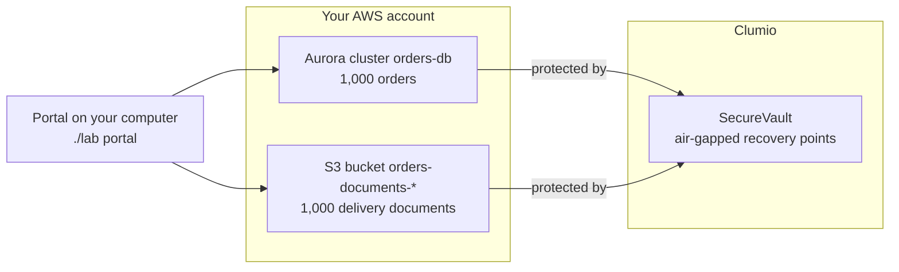

# Orders recovery with Clumio

It's Friday, 17:00. AnyCompany's platform team ships its Friday deployment. Every service stays green, and no alarm fires. By Monday, customers report missing orders and wrong delivery notes.

In this workshop, you run AnyCompany's orders application in a test AWS account, protect it with Clumio, and recover from that Friday. Then you recover from something worse: the database, the bucket, and every copy AWS kept, all deleted. After each recovery, a check proves that every order has its document again.

New to AWS or Clumio? Keep [Words you'll see](../../docs/words.md) open beside this guide.

> [!IMPORTANT]
> Use a test AWS account only. Module 5 deletes the database, the bucket, and their AWS backups on purpose.

**What you'll do:**

- Roll 50 overwritten documents back in place, to a point before the bad deployment.
- Ask an air-gapped archive what the bad deployment deleted, with SQL, and restore nothing.
- Bring back the 100 deleted orders, as records from the archive or from a full restore beside the live database, then check every value and the schema against what was loaded.
- Bring the whole application back after every copy in the account is gone.
- End with a scorecard: each incident, its damage, and your measured time back to HEALTHY.

## At a glance

| | |
|---|---|
| **Audience** | Cloud and platform engineers, and team leads |
| **Level** | Beginner. You type commands in a terminal, and each module gives every command |
| **Time** | Two sessions, up to 48 hours apart. See [Before you start](#before-you-start) |
| **Cost** | One Aurora `db.r6g.large` instance while the workshop runs, and Clumio for what it protects. See [Cost](#cost) |
| **AWS services** | Amazon Aurora with the RDS Data API, Amazon S3, AWS Secrets Manager |
| **Clumio features** | SecureVault Standard and Archive, Backtrack, record restore, and protection as code |
| **Status** | See [what is proven, and what isn't](../../SECURITY.md#what-is-proven-and-what-isnt) |

## Before you start

You need:

- A test AWS account where you can create IAM roles, Aurora, and Amazon S3 resources. The account must not be connected to Clumio already in the Region you use.
- A Clumio user who can create an API token. No Clumio account yet? Start a [free trial](https://portal.clumio.com/register).
- A Clumio tenant that allows deleting AWS connections. Ask your Clumio administrator. Without it, clean-up can't remove the workshop's connection.
- An AWS Region that [Clumio supports](https://documentation.commvault.com/clumio/supported_regions.html).

**Plan for two sessions.** Session 1 builds and protects the application. Session 2 runs the incidents. Between them, Backtrack's first sync can take up to 48 hours.

**The archive may need preparing before you can query it,** which can take up to 48 hours. A new archive recovery point opens at once. Once it has moved to cold storage, you prepare it at the end of Module 1, so it's ready by the second session.

Regulated teams: to have Clumio encrypt its copies with your own AWS KMS key, see [step 1b of the kit](../../1b-own-key/README.md). It's permanent, so it isn't part of this workshop.

## Cost

The workshop runs one Aurora `db.r6g.large` instance. Module 4B adds a restored cluster with its own instance until you delete it. The bucket and the network cost little. Clumio charges for what it protects. [Clean up](docs/7-clean-up.md) stops the AWS charges. Recovery points that Clumio already took stay until their retention ends: 7 days for the database, 30 days for the documents, and 1 month for the archive. That's the shortest Clumio allows; Clumio charges an early-deletion fee for archive recovery points kept under 12 months.

## What is Clumio

Clumio by Commvault protects AWS data, and recovers it at the scope you need: an object, a prefix, a whole bucket or database, or, from the Archive tier, selected database records.

- **SecureVault** keeps copies in Clumio's air-gapped, immutable storage, outside your organization's security domain. Deleting one before its retention ends [takes a request from a Super Admin, approved by a second person](https://documentation.commvault.com/clumio/backup_deletion.html) in your organization, which Clumio then reviews.
- **Backtrack** rolls an S3 bucket back in place, from the versions in your own bucket.
- **Protection as code.** A Clumio policy is a Terraform resource, so it deploys with the application. Clumio works through IAM roles in your account, with no agents or servers to run.

The repo's main README explains [why Clumio](../../README.md#why-clumio), and how it compares with [AWS Backup](../../docs/clumio-and-aws-backup.md).

## What you build

The application stores orders in Amazon Aurora and one delivery document per order in Amazon S3. Each order holds the checksum of its document. A small portal shows one order at a time. It runs on your computer, with your AWS sign-in, so there's nothing public to deploy.

One `terraform apply` builds the application, loads its data, and then turns on its protection. Clumio finds the database and the bucket by their tag, `clumio-protection = orders`.

## Key concepts

**Where Clumio keeps each copy.** Each fits a different incident. [Choose the way back](../../docs/operate.md#choose-the-way-back) turns these into the ways back, by incident.

| Copy | Where it lives | Use it for |
|---|---|---|
| Backtrack | The object versions in your S3 bucket. Clumio rolls a prefix back in place, to a point up to its last daily sync. | Documents overwritten or deleted, while the bucket exists |
| SecureVault Standard, S3 | Clumio's air-gapped vault | Documents lost with the bucket |
| SecureVault Standard, Aurora | Clumio's air-gapped vault | Orders lost or wrong, or the database deleted |
| SecureVault Archive, Aurora | Clumio's air-gapped vault, at lower cost, kept longer | Questions answered, and a few rows back, with SQL, without restoring the whole database |

Aurora's own point-in-time recovery also runs in your account, kept for 7 days by the Clumio policy. This workshop recovers with Clumio's tiers, which also work when the account's own copies are gone.

**A restore creates a new database.** Clumio restores Aurora as a new cluster, beside the original, with a name you choose.

**The check decides.** `./lab check` reads every order and every document. It reports HEALTHY only when all 1,000 orders exist with the values that were loaded, and each document matches its checksum. Order 1 is the control: the bad deployment doesn't touch it, so a correct recovery leaves it as it was.

**Resilience operations.** The modules follow the loop that Commvault's [Resilience Operations (ResOps)](https://www.commvault.com/explore/resilience-operations) describes: discover and protect (Module 1), detect (Module 2), recover and restore (Modules 3 to 5), then measure the result (Module 6). The loop starts from an impact tolerance: how much disruption the business can accept. AnyCompany's is no order lost, and every order back within one hour. `./lab check` is the test of that promise, which ResOps calls a service resilience indicator.

Clumio can also restore into another connected account or Region, for an outage or a fresh test environment. During a real incident, start from [Choose the way back](../../docs/operate.md#choose-the-way-back).

## Modules

| Module | You learn to |
|---|---|
| [0. Set up](docs/0-setup.md) | Install the tools, sign in, and check that the account is ready |
| [1. Deploy and protect](docs/1-deploy.md) | Deploy the application with its data and its protection, in one apply |
| [2. Break](docs/2-break.md) | Ship AnyCompany's Friday deployment, and measure what it did |
| [3. Recover the documents](docs/3-documents.md) | Roll documents back in place with Backtrack |
| [4A. Recover the orders from the archive](docs/4a-records.md) | Bring back only the lost rows, with SQL on the archive, then prove the schema and every value |
| [4B. Recover the whole database](docs/4b-database.md) | Restore the whole database beside the live one, for damage of any size |
| [5. Survive](docs/5-survive.md) | Recover after the database, the bucket, and their AWS backups are deleted |
| [6. Prove](docs/6-prove.md) | Read your scorecard, with Clumio's task records |
| [7. Clean up](docs/7-clean-up.md) | Delete the workshop, then take the next step on your own data |
| [Reference](docs/reference.md) | Which way back this workshop practices, how data moves, commands, troubleshooting |

Start with [0. Set up](docs/0-setup.md).

## What's in this folder

| Path | What it is |
|---|---|
| `lab` | The workshop's commands. Every command checks first, and says what to do next |
| `main.tf` | The workshop: the application, its data, the Clumio connection, and two Clumio policies |
| `app/` | The application: network, Aurora cluster, and S3 bucket |
| `names.json` | Every resource name, shared by Terraform and `lab`. `{account}` and `{region}` are filled in from `terraform.tfvars`. Change the names only if your organization's naming rules require it: the guide shows the defaults |
| `terraform.tfvars.example` | Your settings: the test account and the Region |
| `docs/` | The workshop, one page per module |
| `AGENTS.md` | For an AI agent that runs the commands: the safety rules, and the run in order |

The Clumio policies come from this repo's `modules/`, the same modules its production steps use.
