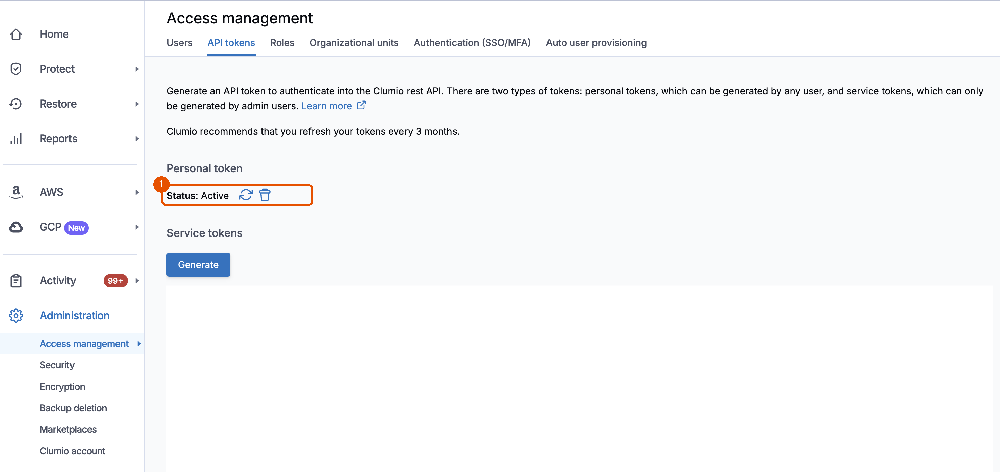

# 0. Set up

You need a test AWS account, a Clumio user, and a few command-line tools. In this module, you install the tools, sign in to both services, and check that the account is ready.

Ask your Clumio administrator to confirm that your tenant allows deleting AWS connections: clean-up in Module 7 needs it. On a free trial, ask Clumio support.

> [!IMPORTANT]
> Use a test account only. Module 5 deletes the database, the bucket, and their AWS backups.

## Get a test account

A test account is an AWS account with no real data. The workshop builds a small application there, breaks it on purpose, and deletes it at the end.

- Ask your cloud or platform team for one, with administrator access. Many companies keep a sandbox account for this.
- Or open your own AWS account. It isn't free: the workshop runs a database for a day or two. See [Cost](../README.md#cost).

## Install the tools

1. Open a terminal. On macOS, install the tools with [Homebrew](https://brew.sh):

   ```bash
   brew install awscli git python
   brew install hashicorp/tap/terraform
   ```

> [!NOTE]
> On Linux, use your package manager. On Windows, use WSL with Ubuntu. The workshop needs Terraform, the AWS CLI version 2, Git, and Python 3.9 or later.

## Sign in to AWS

2. Configure sign-in with AWS IAM Identity Center, the way most companies give people access to AWS. Enter the start URL and Region from your administrator, and choose the test account. For the profile name, enter `orders-test`. Press Enter to accept the other defaults.

   ```bash
   aws configure sso
   ```

3. Sign in, and use the profile in this terminal.

   ```bash
   aws sso login --profile orders-test
   export AWS_PROFILE=orders-test
   ```

> [!NOTE]
> Any AWS CLI sign-in to the test account works. If you already have one, skip steps 2 and 3, and run `export AWS_PROFILE=<your profile>`. Opened your own account? Set up IAM Identity Center with [AWS's getting-started guide](https://docs.aws.amazon.com/singlesignon/latest/userguide/getting-started.html), then follow steps 2 and 3.

4. Choose an AWS Region that [Clumio supports](https://documentation.commvault.com/clumio/supported_regions.html). In the AWS Management Console, at the top right, choose that Region. In any other Region, the workshop's resources don't appear.

## Get a Clumio API token

5. Create an API token: a password that lets commands use Clumio for you. Sign in to the Clumio console. Choose **Administration**, **Access management**, **API tokens**. Next to **Personal token**, choose the refresh icon. Clumio shows the token once. Copy it now, and keep it secret.

   

6. Pass the token to this terminal. Paste the token, then press Enter. It stays out of your shell history.

   ```bash
   read -rs CLUMIO_API_TOKEN && export CLUMIO_API_TOKEN
   ```

7. Set the Clumio API URL. If you sign in at portal.clumio.com, use the URL below. For other portals, see the table in [Before you begin](../../../README.md#before-you-begin).

   ```bash
   export CLUMIO_API_BASE_URL=https://us-west-2.api.clumio.com
   ```

## Get the workshop

8. Get the workshop from GitHub, and open its folder.

   ```bash
   git clone https://github.com/ntcsteve/get-started-clumio-aws
   cd get-started-clumio-aws/workshops/orders-recovery
   ```

9. Create your settings file.

   ```bash
   cp terraform.tfvars.example terraform.tfvars
   ```

10. Open `terraform.tfvars` in a text editor. For `account_id`, enter the 12-digit test account ID. For `region`, enter the Region you chose in step 4.

    ```hcl
    account_id = "123456789012"
    region     = "ap-southeast-1"
    ```

    If your organization requires tags, or a permissions boundary on IAM roles, set them in the same file. Its comments show how. Otherwise, leave them as they are.

    Leave `archive_retention_months = 1`. It keeps archive recovery points as short as Clumio allows. Clumio charges an early-deletion fee for archive recovery points kept under 12 months.

## Check that the account is ready

11. Run the preflight check. It changes nothing. It confirms that your tools, AWS sign-in, Region, and Clumio token are ready, and that this account and Region aren't already connected to Clumio.

    ```bash
    ./lab preflight
    ```

    **You should see** these lines:

    ```text
    AWS: signed in to 123456789012, Region ap-southeast-1
    Aurora MySQL default 8.0.mysql_aurora.3.08.2: supports the RDS Data API
    Clumio: token and API URL accepted
    Clumio: supports ap-southeast-1
    READY: run terraform init && terraform apply
    ```

> [!NOTE]
> Each line from `./lab` starts with the time in UTC. This guide shows the time only where you need it.
>
> The token is never saved to a file. In a new terminal, [start a session](#start-a-session). If a command prints `STOP`, the message says what to fix. See [Troubleshooting](reference.md#troubleshooting).

**Key takeaway:** Every `./lab` command checks before it acts. Settings, sign-in, and the token are confirmed before anything costs money.

## Start a session

Do this in every new terminal, such as when you come back for session 2. A sign-in and a token don't carry over to a new terminal, and an IAM Identity Center sign-in expires after a set time.

```bash
cd get-started-clumio-aws/workshops/orders-recovery
aws sso login --profile orders-test        # or sign in your own way (step 3)
export AWS_PROFILE=orders-test
read -rs CLUMIO_API_TOKEN && export CLUMIO_API_TOKEN   # paste the token (step 6)
export CLUMIO_API_BASE_URL=https://us-west-2.api.clumio.com   # your portal's URL (step 7)
```

If Clumio refuses the token, create a new one as in step 5. Then start the portal in a second terminal, as in [Module 1, step 3](1-deploy.md#deploy).

**Next:** [1. Deploy and protect](1-deploy.md)
