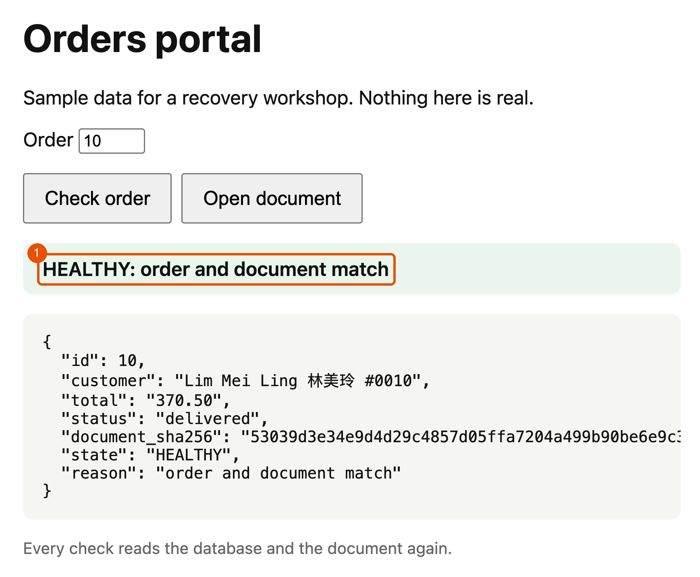
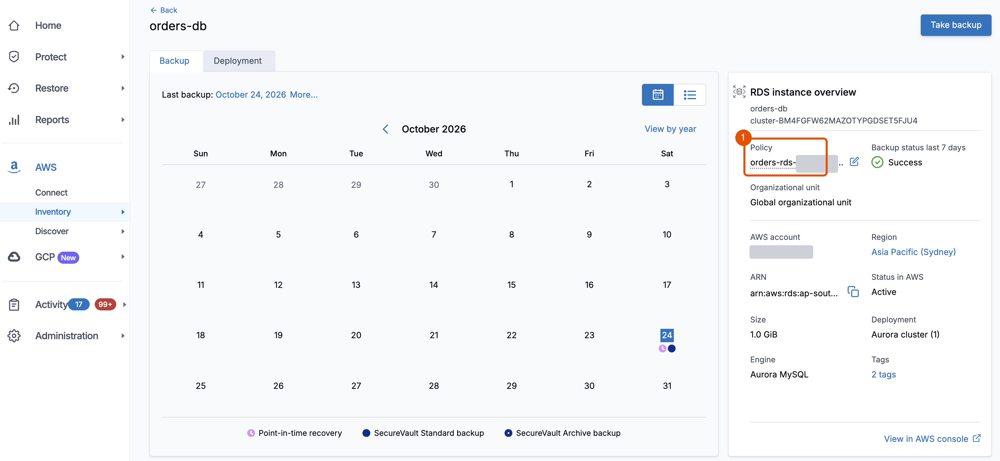
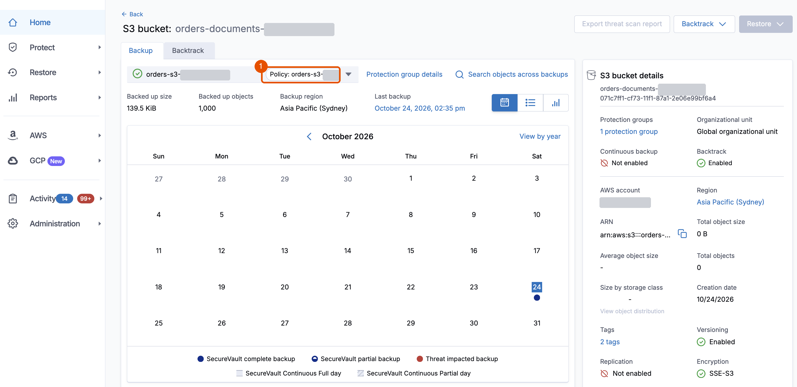
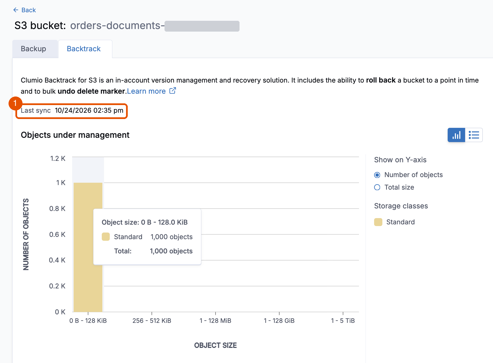
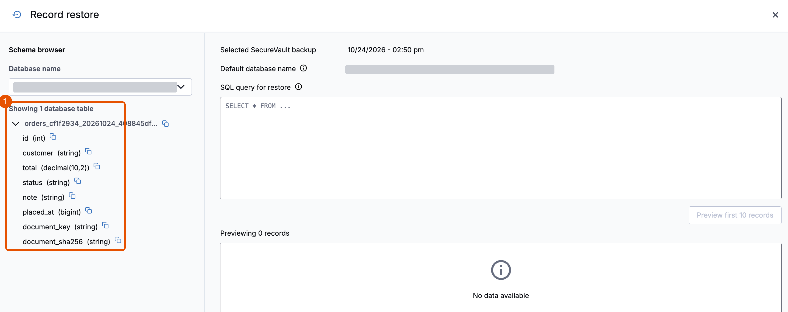

# 1. Deploy and protect

**Requires:** [0. Set up](0-setup.md)

AnyCompany deploys its orders application with Terraform, and its Clumio policies are part of the same code. In this module, one `terraform apply` builds the application, loads 1,000 orders and their documents, and then turns on protection. Because the data goes in first, Clumio's first recovery points already hold it.

## Deploy

1. Deploy the application, its data, and its protection. Terraform lists what it will create, then asks. Enter `yes`.

   ```bash
   terraform init
   terraform apply
   ```

   Terraform builds four parts. The Clumio connection builds alongside the application. The policies wait for the data, so Clumio's first recovery points hold it.

   | Part | What it is |
   |---|---|
   | Application | A private network, the Aurora cluster `orders-db` with its login secret, and the S3 bucket `orders-documents-<account ID>-<region>` |
   | Sample data | 1,000 orders and 1,000 delivery documents, loaded by `./lab seed` once the application is built |
   | Clumio connection | Clumio's connection to this account and Region, with the IAM roles Clumio uses |
   | Clumio policies | One for the database and one for the bucket, created last. Each protects every resource tagged `clumio-protection = orders` |

   **You should see**, among the output, the data being loaded, then `Apply complete!`:

   ```text
   terraform_data.sample_data (local-exec): [06:32:21 UTC] Seeded 1,000 orders and 1,000 documents, deployment 7f3a9c21. Next: ./lab check
   ```

   This is the database's protection, from `main.tf`, abridged. Production uses the same module.

   ```hcl
   module "rds_protection" {
     source       = "../../modules/clumio-rds-protection"
     protect_by   = "tag"
     database_tag = local.names.protection_tag

     pitr_retention_days      = 7
     standard_retention_days  = 7
     archive_retention_months = var.archive_retention_months
     # ...
   }
   ```

> [!IMPORTANT]
> Don't run `terraform apply` again after this module. After the incidents and restores, the account no longer matches what Terraform built, and Terraform would try to change it back. In Module 5, it could replace the database that Clumio restored. Recovery happens in Clumio and with `./lab`. Terraform builds the workshop once, and `./lab down` removes it once.

2. Check the application's data.

   ```bash
   ./lab check
   ```

   **You should see:**

   ```text
     schema               matches
     totals               1000 orders, 2419000.00 in total, 142 notes NULL
     orders missing       0
     orders changed       0
     documents missing    0
     documents changed    0
     control order 1      intact
   HEALTHY
   ```

3. Start the portal. Open a second terminal, go to the workshop folder, and run these. The portal needs only your AWS sign-in.

   ```bash
   export AWS_PROFILE=orders-test   # or your own profile, as in Set up
   ./lab portal
   ```

   Open `http://localhost:8080` in a browser. Enter `10`, and choose **Check order**. Keep this terminal and this tab open: every module comes back to them.

   **You should see** `HEALTHY: order and document match`. If the page says `CAN'T CHECK`, do what it says, such as `aws sso login`.

   

## See what Clumio protects

4. In the Clumio console, choose **AWS**, **Inventory**, **RDS resources**, then `orders-db`. Its page shows the policy `orders-rds-<account ID>-<region>`, and a calendar with its recovery points. Then choose **AWS**, **Protect**, **S3**, **Protection Groups**, then `orders-s3-<account ID>-<region>`, and choose the bucket. Its page shows the protection group, the policy, and the objects backed up. Clumio found both by their tag. A new database or bucket with the same tag would be protected too, with no change to the code.

   

   

   The bucket page can show **Total objects** as `0` for a while after the first backup. Clumio's inventory catches up later. **Backed up objects** is the number that counts.

   The console shows times in your browser's time zone, on a 12-hour clock, with no zone label. The lab shows every time in UTC.

## Wait for the first recovery points

5. Check Clumio's recovery points of the database and the documents.

   ```bash
   ./lab status
   ```

   The first line names this deployment, by an ID that `./lab seed` wrote into the database, and the day it loaded the data. If Clumio lists more than one `orders-db` later, your account ID and this time tell you which is yours.

   **You should see** `ready for the incidents  yes` on the last line. If it says `no`, it names what's missing: wait, and run the command again later. In the test run, the documents' first recovery point was there within 3 minutes, and both of the database's within 25 minutes of its policy taking effect.

   ```text
     deployment               7f3a9c21, seeded 2026-10-24 06:32 UTC
     database in Clumio       found
       protected by           the workshop's policy
       SecureVault Standard   2026-10-24T06:50:52Z
       SecureVault Archive    2026-10-24T06:50:52Z
     documents in Clumio      found
       SecureVault Standard   2026-10-24T06:35:18Z
     ready for the incidents  yes: Clumio holds recovery points of the loaded data
   ```

   `ready` waits for all three: the database's Standard and Archive recovery points, and the documents'. `./lab break` checks the same thing, and refuses to start an incident before Clumio holds a copy to recover from.

6. In the Clumio console, choose **AWS**, **Protect**, **S3**, **Protection Groups**, then `orders-s3-<account ID>-<region>`. Open the **Backtrack** tab.

   **You should see** a date and time for **Last sync**, and `1,000` for **Objects under management**. If the tab says **Waiting for Inventory**, Backtrack hasn't synced yet. Its first sync can take up to 48 hours, and only the console shows it. In the test run, it synced 3 minutes after the data was loaded.

   

   Backtrack syncs once a day. You can roll the bucket back only to a point up to its last sync. Changes made after that point roll back too.

7. Get the archive ready to query. In the Clumio console, choose **AWS**, **Inventory**, **RDS resources**, then `orders-db`. In the calendar, choose the archive recovery point: its dot has a ring. Under **SecureVault Archive backup**, choose **Restore**. One of two things happens:

   - **Record restore opens**, with a **Schema browser** that lists the `orders` table. The archive recovery point is new, and hasn't moved to cold storage yet, so it's ready now. This is what the test run saw, 30 minutes after the archive backup.
   - **Clumio offers Prepare records for restore.** The point is in cold storage. Choose it now, so the archive is ready when you come back. Preparing can take up to 48 hours. Clumio emails you when it's ready, and you can query it for 7 days.

   

   This ends session 1. Start Module 2 when the Backtrack tab shows a **Last sync**. The archive can still be preparing: Module 2 says what to do. When you come back, first [start a session](0-setup.md#start-a-session).

**Key takeaway:** The protection deployed with the application, as code. Every resource with the tag is protected, including ones created later.

**Next:** [2. Break](2-break.md)
