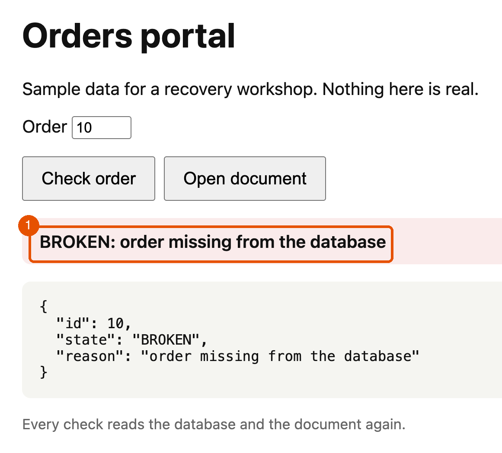
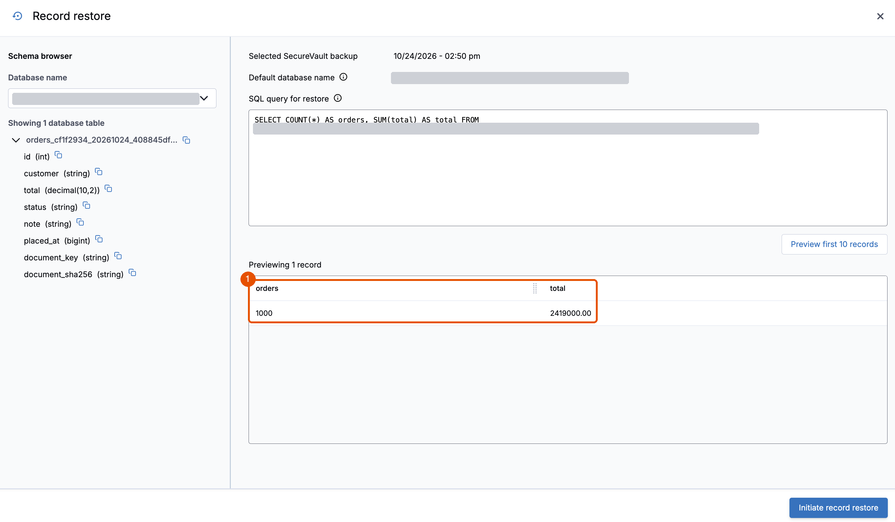

# 2. Break

**Requires:** [1. Deploy and protect](1-deploy.md), with the first recovery points in place. Back after the wait? First [start a session](0-setup.md#start-a-session).

Friday, 17:00. AnyCompany's deployment includes a database migration with a wrong `WHERE` clause, and a template change for delivery notes. Both were reviewed, both had permission, and both run without an error. Every service stays up, and nothing raises an alarm. In this module, you ship that deployment and measure what it did.

1. Confirm the starting point.

   ```bash
   ./lab check
   ```

   **You should see** `HEALTHY` on the last line.

2. Ship the deployment. It deletes every tenth order from the database, and overwrites 50 delivery documents in the bucket.

   ```bash
   ./lab break deploy
   ```

   **You should see:**

   ```text
   [08:48:35 UTC] Bad deployment at 2026-10-24 08:48:35 UTC: 100 orders deleted, 50 documents overwritten. Next: ./lab check
   ```

3. Write down the date and time from that line. This is the change time: every recovery goes to a point before it. The lab shows every time in UTC. The Clumio console shows times in your browser's time zone, so convert the change time to it, date included. For example, 08:48 UTC is 4:48 pm in Singapore (UTC+8).

4. Check the data.

   ```bash
   ./lab check
   ```

   **You should see:**

   ```text
     schema               matches
     totals               900 orders, 2170450.00 in total, 128 notes NULL
     orders missing       100
     orders changed       0
     documents missing    0
     documents changed    50
     control order 1      intact
   BROKEN
   ```

5. In the portal, check order `10`. The page loads, and the order is missing. Check order `15`: it exists, but its delivery document changed. The application is up, and the business is broken.

   

6. If the archive is still preparing (Module 1, step 7), skip this step, and do it at the start of Module 4. Otherwise, ask the archive what was there before the bad deployment, with nothing restored. Open **Record restore** on the archive recovery point from Module 1. In **Schema browser**, next to the `orders_…` table, not `deployment_…`, choose the copy icon. It copies the table's full name, in the form `<database>.<table>`. Then enter this with the name you copied, and choose **Preview first 10 records**:

   ```sql
   SELECT COUNT(*) AS orders, SUM(total) AS total FROM <orders table>
   ```

   **You should see** `1000` and `2419000.00`: every order from before the bad deployment, answered from an air-gapped copy. The live database has 900. Name each result with `AS`, as here: without it, the console labels the columns `_col0` and `_col1`. To see three of the deleted orders themselves:

   ```sql
   SELECT id, customer, total FROM <orders table> WHERE id IN (10, 20, 30) ORDER BY id
   ```

   

> [!NOTE]
> The bad deployment did two kinds of damage, in two places: orders missing from the database, and documents changed in the bucket. Module 3 recovers the documents, and Module 4 recovers the orders.

**Key takeaway:** Most data incidents aren't outages. A check against the data shows what changed. The archive shows what was there before, without restoring anything.

**Next:** [3. Recover the documents](3-documents.md)
