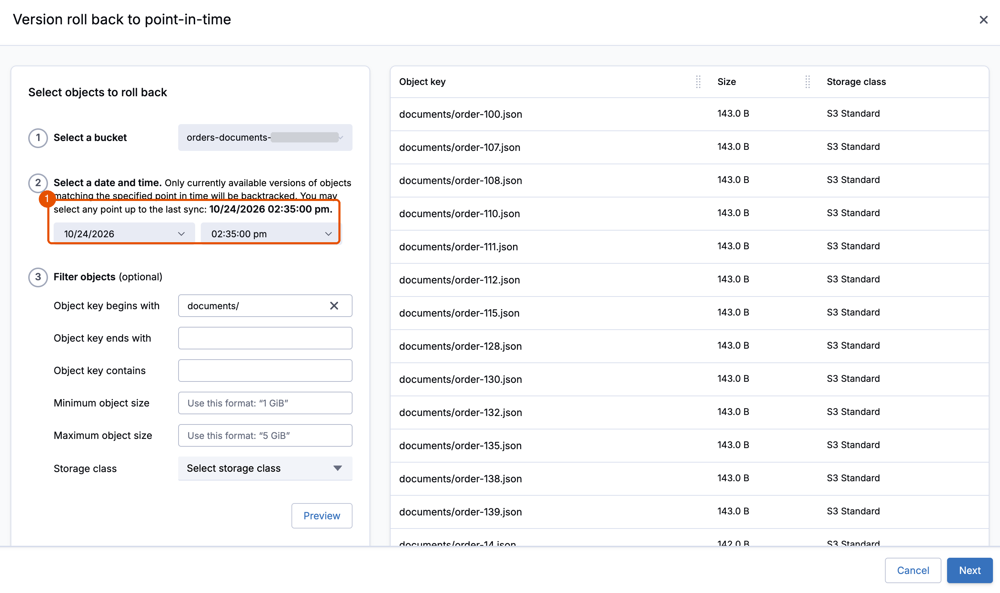
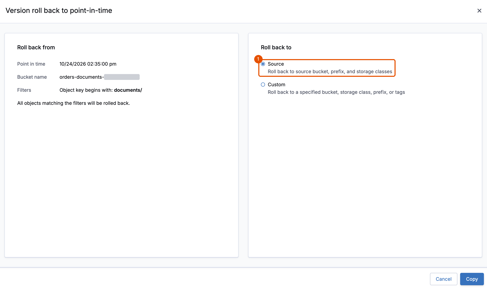
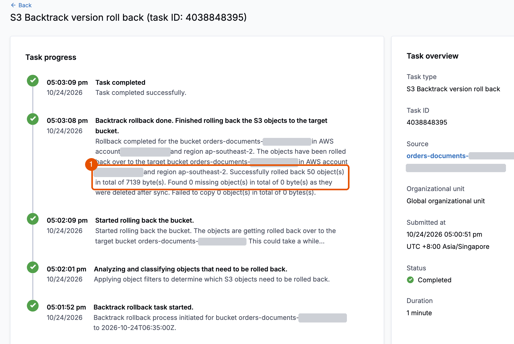

# 3. Recover the documents

**Requires:** [2. Break](2-break.md). In a new terminal, first [start a session](0-setup.md#start-a-session).

The bad deployment overwrote 50 documents, but the bucket still exists, and S3 Versioning kept every earlier version. Clumio Backtrack uses those versions to roll a prefix back in place, to a point in time you choose, up to its last daily sync. In this module, you roll the documents back to a point before the bad deployment.

**With S3 Versioning alone:** the old versions are kept, but bringing them back means finding the right version of each object and copying it over the current one, object by object, with a script you write during the incident.

1. In the Clumio console, choose **AWS**, **Protect**, **S3**, **Protection Groups**. Choose `orders-s3-<account ID>-<region>`.

2. On the **Backtrack** tab, choose **Backtrack**, then **Roll back**. Select the bucket `orders-documents-<account ID>-<region>`.

3. Select the date and time to roll back to. The form says how far it can go: any point up to the last sync. Choose a time before the change time from Module 2, and as close to it as the form allows. In the test run, the last sync was 2 hours before the bad deployment, so that sync was the point. A document written between that point and the bad deployment would roll back too, to its version at that point. For the object key filter, choose **Object key begins with**, and enter `documents/`.

   

4. Choose **Preview** to see the versions that Backtrack will restore. It lists up to 100 of the objects under `documents/`, at their size from before the bad deployment. If it lists none, Backtrack hasn't synced since the documents were loaded: wait for its next daily sync, then try again.

5. Choose **Next**. For **Destination**, choose **Source**. It rolls each document back in the same bucket, at the same key, in the same storage class.

   

6. Choose **Copy**. To follow the restore, choose **Activity**, **Tasks**. In the test run, it took under 2 minutes.

   **You should see** the task complete, with 50 objects rolled back and 0 failed. Backtrack copied back only the 50 documents that had changed.

   

> [!NOTE]
> **While you wait:** Backtrack copies each object's version from before your chosen time back as its current version, inside your bucket. The data never leaves your account, and the application needs no change.

7. When the task completes, check the data.

   ```bash
   ./lab check
   ```

   **You should see:**

   ```text
     schema               matches
     totals               900 orders, 2170450.00 in total, 128 notes NULL
     orders missing       100
     orders changed       0
     documents missing    0
     documents changed    0
     control order 1      intact
   BROKEN
   ```

8. In the portal, check order `15`: HEALTHY again. Order `10` is still missing, because the documents are back but 100 orders aren't. Module 4 recovers them.

> [!NOTE]
> Backtrack works only while the bucket and its versions exist. If they are deleted, recover from SecureVault instead, as in Module 5.

**Key takeaway:** Backtrack recovers objects in place, to a point up to its last daily sync, with no new bucket and no change for the application.

**Next:** [4. Recover the orders](4-orders.md)
