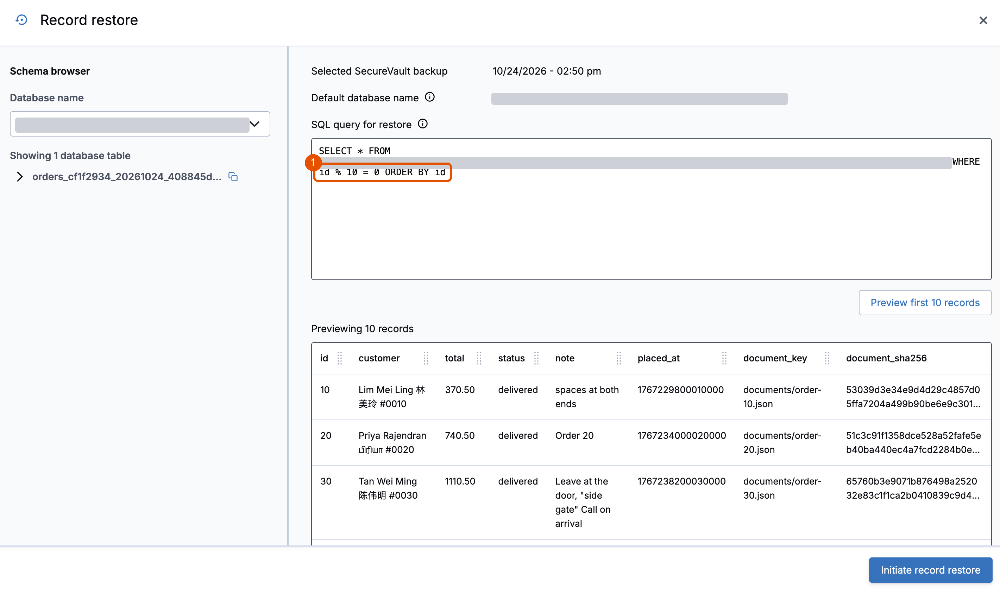
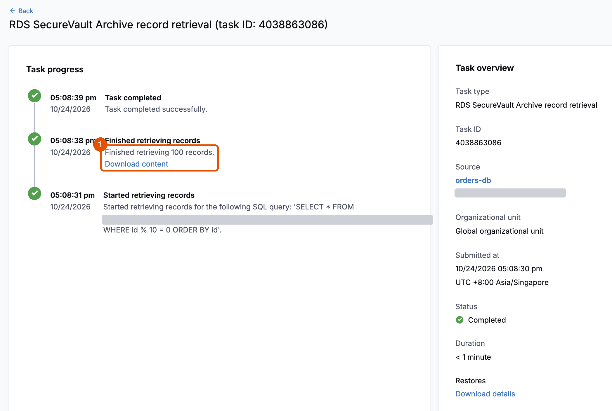

# 4A. Recover the orders from the archive

**Requires:** [3. Recover the documents](3-documents.md). In a new terminal, first [start a session](0-setup.md#start-a-session).

The bad deployment deleted 100 orders. Customers kept ordering since, so rolling the whole database back would lose their orders too. Instead, you bring back only the 100 that are missing. You do it two ways, in order. In a real incident, you'd pick one, by the size of the damage.

| Way back | When to use it | What it takes |
|---|---|---|
| **4A. Records** (first) | A few rows that existed at the last monthly archive recovery point | SQL on an archive recovery point returns just those rows, with no restore. Preparing the archive can take up to 48 hours |
| **4B. Whole database** (then) | Damage of any size | A full restore beside the original. You copy back only what's missing |

**With AWS's own backups:** a restore brings back the whole cluster. Then you find the 100 rows and copy them back yourself.

Skipped Module 2, step 6, because the archive was still preparing? You can run its two queries now, before step 3, to see what was there before the bad deployment.

**Requires:** the archive recovery point from [Module 1, step 7](1-deploy.md#wait-for-the-first-recovery-points), ready to query. It was taken before the bad deployment, so it holds every order the bad deployment deleted.

1. Open **Record restore**: from Clumio's email, or in the Clumio console under **AWS**, **Inventory**, **RDS resources**, `orders-db`, by choosing **Restore** on that archive recovery point. If Clumio lists more than one `orders-db`, first, at the top of **Inventory**, choose your account in **All accounts** and your Region in **All regions**.

   Clumio offers **Prepare records for restore** instead? The point is in cold storage. Choose it, and come back when Clumio emails that it's ready, which can take up to 48 hours. If no archive recovery point is from before the change time, use 4B.

> [!NOTE]
> Clumio makes the archive recovery point ready for SQL in its own vault. Nothing is restored into your account.

2. In **Schema browser**, next to the `orders_…` table, not `deployment_…`, choose the copy icon. It copies the table's full name.

3. Enter this query with the name you copied, and choose **Preview first 10 records**. It selects every tenth order: exactly the ones the bad deployment deleted. Without `ORDER BY`, the preview shows them in no set order.

   ```sql
   SELECT * FROM <orders table> WHERE id % 10 = 0 ORDER BY id
   ```

   **You should see** orders 10, 20, 30, and so on.

   

4. Choose **Initiate record restore**. Only these 100 rows leave the vault, as a CSV file. When it's ready, choose **Activity**, **Tasks**, then the record retrieval task, and choose **Download content**. In the test run, the task took 8 seconds.

   

5. Load the missing orders back. Drag the CSV from your Downloads folder into the terminal to paste its path. The command checks every row, then copies only the orders that are missing.

   ```bash
   ./lab repair --from-csv <the CSV file>
   ```

   **You should see:**

   ```text
   Copied 100 of 100 missing orders from <the CSV's file name>. Next: ./lab check
   ```

6. Verify against the archive. In **Record restore**, preview these two:

   ```sql
   SELECT COUNT(*) AS orders, SUM(total) AS total FROM <orders table>
   ```

   ```sql
   SELECT COUNT(*) AS null_notes FROM <orders table> WHERE note IS NULL
   ```

   **You should see** `1000` and `2419000.00`, then `142`. In the next step, `./lab check` shows the same orders, total and NULL count. Clumio's CSV keeps NULL apart from empty text: NULL is an empty field, and empty text is `""`. The repair reads them that way. If a spreadsheet re-saves the file, that difference is lost, and the check reports it as `orders changed  14 (note: 14)`, BROKEN. So download the CSV, and pass it to `./lab` untouched.

> [!NOTE]
> Use `%` for remainders, not `MOD`. Error code 111 means the table name is incomplete: copy it again with the copy icon.

## Check the application

1. Check the data.

   ```bash
   ./lab check
   ```

   **You should see:**

   ```text
     schema               matches
     totals               1000 orders, 2419000.00 in total, 142 notes NULL
     orders missing       0
     orders changed       0
     documents missing    0
     documents changed    0
     control order 1      intact
   HEALTHY
   ```

   `orders changed  0` means every value matches what `./lab seed` loaded, down to the 142 notes that are NULL rather than empty. `schema  matches` means the database still has the columns, types and indexes `./lab seed` created.

2. In the portal, check order `10`: HEALTHY again. AnyCompany has every order back.

### Is the schema right?

```text
 ./lab seed      CREATE TABLE orders ...  ──▶  saves the schema to .lab/schema.json
 ./lab check     reads the schema now     ──▶  compares: columns (name, type, NULL), indexes
                                                 same       ▶ schema  matches
                                                 different  ▶ schema  different: <what>  ▶ BROKEN

 Records (4A)    CSV: rows only  ──▶ into the existing table ──▶ the check proves the table
 Full (4B, 5)    the database    ──▶ rows and definition     ──▶ the check proves the definition came back
```

A record restore returns rows, not the table's definition. The CSV holds values; the table they go into is the one already in the live database. So the question a DBA asks after 4A is two questions: did the rows come back exactly, and is the table still the table it should be? `./lab check` answers both, three ways:

| Check | How | After 4A |
|---|---|---|
| The schema | Every column's name, type and nullability, and every index, against the copy `./lab seed` saved in `.lab/schema.json` | `schema  matches` |
| Every value | All 8 columns of all 1,000 orders against what was loaded. A value written another way, such as `370.5` for `370.50`, is the same value | `orders changed  0` |
| An independent count | The archive's own SQL, `COUNT(*)`, `SUM(total)` and the NULL count, against the `totals` line | `1000`, `2419000.00`, `142` on both sides |

Two things to know before you rely on it in production:

- **The archive's types aren't the database's.** The Schema browser lists `placed_at` as `bigint`, and the CSV writes it as microseconds since 1970 in UTC. `./lab repair --from-csv` converts it back to `DATETIME(3)`, and checks every row before it writes. Validate against the live schema, never the archive's.
- **Rows can't repair a structure.** If a deployment drops a column, changes a type or removes an index, the CSV has nowhere to go. Restore the whole database instead, as in 4B or Module 5: it comes back with its schema, and `./lab check` compares that schema the same way. In production, keep the table definitions in versioned migrations, so you can compare a restore with what should be there.

### In production: the same steps in SQL

> [!WARNING]
> Not run live. The `./lab` path above was proven in the test run. This SQL follows [MySQL's documented behavior](https://dev.mysql.com/doc/refman/8.0/en/load-data.html). Test the `CASE` column in Clumio's record restore, and `LOAD DATA` on Aurora MySQL 3, before you rely on it.

`./lab repair --from-csv` stages the file, checks it, and copies only the missing orders. Without `./lab`, a DBA does the same in four steps: stage, validate, merge, reconcile. Two details decide whether the data comes back exact:

- **NULL.** MySQL's `LOAD DATA` reads an empty field as empty text, and only `\N` or a bare `NULL` as NULL. Clumio's CSV writes NULL as an empty field, so a plain `LOAD DATA` turns every NULL note into empty text, and `./lab check` reports `orders changed  14 (note: 14)`, BROKEN. Add a column to the record-restore query that says which notes are NULL, and use it when you load.
- **Times.** The archive writes `placed_at` as microseconds since 1970, in UTC. Set the session to UTC before you convert, or every time shifts by your offset.

The record-restore query, with the extra column:

```sql
SELECT *, CASE WHEN note IS NULL THEN 1 ELSE 0 END AS note_is_null
FROM <orders table> WHERE id % 10 = 0 ORDER BY id
```

Then, in the database:

```sql
-- 1. Stage: an empty copy of the table, loaded from the CSV
SET time_zone = '+00:00';
CREATE TABLE orders_restore LIKE orders;
LOAD DATA LOCAL INFILE 'orders.csv' INTO TABLE orders_restore
  CHARACTER SET utf8mb4
  FIELDS TERMINATED BY ',' ENCLOSED BY '"' ESCAPED BY ''
  LINES TERMINATED BY '\n' IGNORE 1 LINES
  (id, customer, total, status, @note, @placed_at, document_key, document_sha256, @note_is_null)
  SET note = IF(@note_is_null = '1', NULL, @note),
      placed_at = FROM_UNIXTIME(@placed_at / 1000000);

-- 2. Validate: these must equal the archive's own answer (100, the total, and the NULL count)
SELECT COUNT(*), SUM(total), SUM(note IS NULL) FROM orders_restore;
SELECT COUNT(*) FROM orders_restore r JOIN orders o USING (id);   -- 0: only missing orders

-- 3. Merge: only the orders that are missing, in one transaction
START TRANSACTION;
INSERT INTO orders SELECT * FROM orders_restore r
  WHERE NOT EXISTS (SELECT 1 FROM orders o WHERE o.id = r.id);
COMMIT;

-- 4. Reconcile: every column, NULL-safe (<=>); 0 means identical
SELECT COUNT(*) FROM orders o JOIN orders_restore r USING (id)
  WHERE NOT (o.customer <=> r.customer AND o.total <=> r.total AND o.status <=> r.status
         AND o.note <=> r.note AND o.placed_at <=> r.placed_at
         AND o.document_key <=> r.document_key AND o.document_sha256 <=> r.document_sha256);
DROP TABLE orders_restore;
```

On Aurora, `LOAD DATA FROM S3` loads the file from a bucket instead of your computer. It needs an IAM role on the cluster: see [Loading data into Aurora MySQL from Amazon S3](https://docs.aws.amazon.com/AmazonRDS/latest/AuroraUserGuide/AuroraMySQL.Integrating.LoadFromS3.html). Then compare the table's definition with your migrations: `SHOW CREATE TABLE orders`.

**Next:** [4B. Recover the whole database](4b-database.md)
