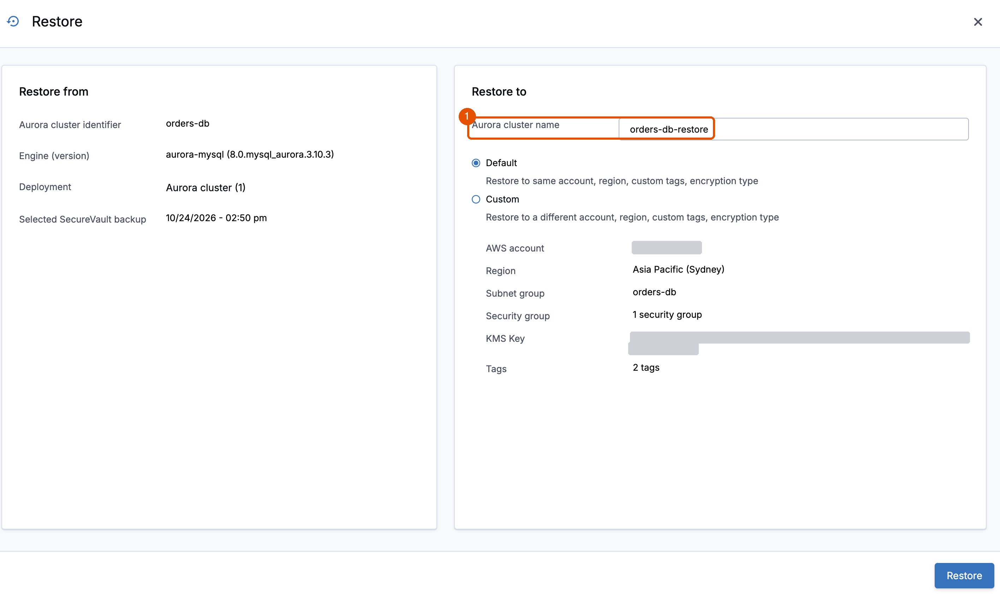

# 4B. Recover the whole database

**Requires:** [4A. Recover the orders from the archive](4a-records.md). Skipped 4A because the archive wasn't ready? Start here: 4B brings the orders back on its own.

If you did 4A, the orders are back already. Now see the way you'd use for wide damage: a full restore beside the live database.

> [!IMPORTANT]
> Name the restored cluster `orders-db-restore`, as in step 2. `./lab drop` and `./lab down` recognize a restore by the tag `Workshop = orders-recovery`, which it keeps from `orders-db`. They delete nothing without that tag.

1. In the Clumio console, choose **AWS**, **Inventory**, **RDS resources**, then `orders-db`. If more than one is listed, first, at the top of **Inventory**, choose your account in **All accounts** and your Region in **All regions**: other learners on the same Clumio tenant can have one too. Then choose the one that's in AWS, not deleted. A restore with **Default** settings goes to the source's account, so the wrong one would land in someone else's.

2. Choose the last SecureVault Standard recovery point before the change time, then **Restore**. Choose **Default** first. Then replace the name Clumio suggests in **Aurora cluster name** with `orders-db-restore`. Switching between **Default** and **Custom** clears the name, so check it before you choose **Restore**.

   

3. To follow the restore, choose **Activity**, **Tasks**. When it completes, `orders-db-restore` appears in the Amazon RDS console. In the test runs, it took 15 to 20 minutes. If the cluster has another name, such as `restored-orders-db-<number>`, see [Troubleshooting](reference.md#troubleshooting).

   The restored cluster keeps the original's tags, including `clumio-protection = orders`. So the workshop's policy protects it too, and Clumio starts backing it up at once. The RDS console shows it as **Backing-up** for a while. The steps below still work.

> [!NOTE]
> **While you wait:** Clumio copies the recovery point from its vault into your account as a snapshot, builds the new cluster from it, then deletes the snapshot. The live database stays online throughout.

4. Make the restored cluster ready for SQL. A restore arrives with the RDS Data API turned off, and can arrive without an instance. The command adds what is missing, then waits. In the test run, it took 4 minutes.

   ```bash
   ./lab prepare orders-db-restore
   ```

   **You should see:**

   ```text
   orders-db-restore answers SQL
   ```

5. Compare the restored cluster with the live database. The command copies only the orders that `orders-db` lacks.

   ```bash
   ./lab repair --from orders-db-restore
   ```

   **You should see** this, because 4A already brought the orders back:

   ```text
   No orders are missing. Nothing to copy
   ```

   With wide damage, this is the step that copies them back. Skipped 4A? Then you see `Copied 100 of 100 missing orders from orders-db-restore` instead. Run [Check the application](4a-records.md#check-the-application) before you go on.

6. Delete the restored cluster. It has done its job, and it runs an instance.

   ```bash
   ./lab drop orders-db-restore
   ```

   **You should see:**

   ```text
   orders-db-restore deleted
   ```

**Key takeaway:** Choose the way back by the size of the damage: a few rows from the archive, or a whole database beside the original. Either way, the live database stays online. Only missing orders are copied, so in production, orders placed since the bad deployment stay as they are.

**Next:** [5. Survive](5-survive.md)
