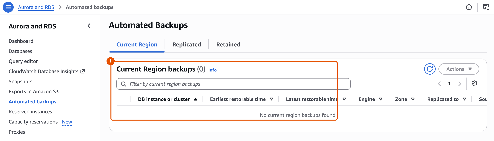
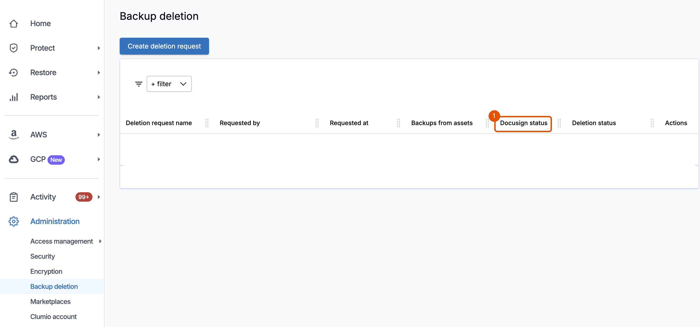
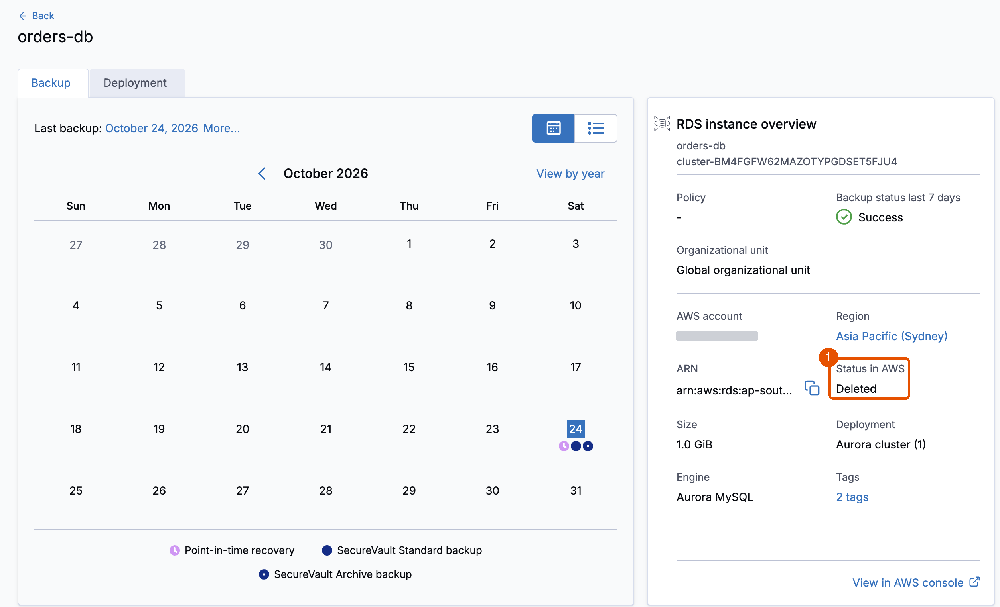
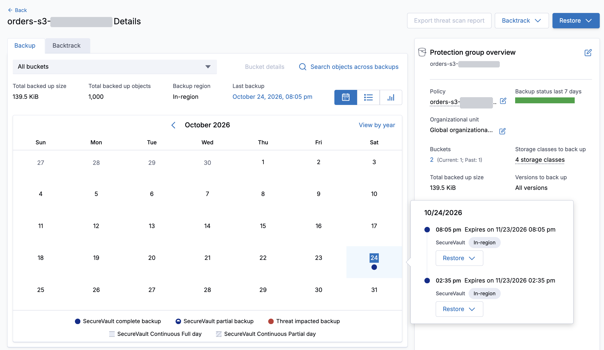
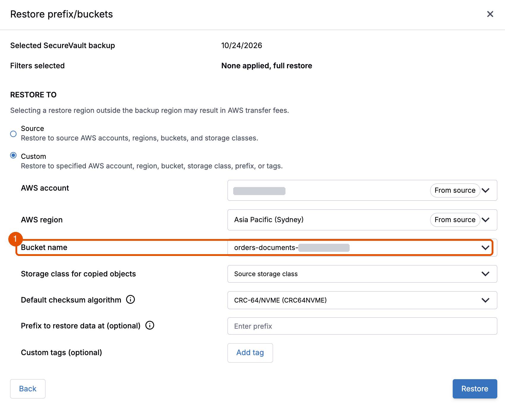
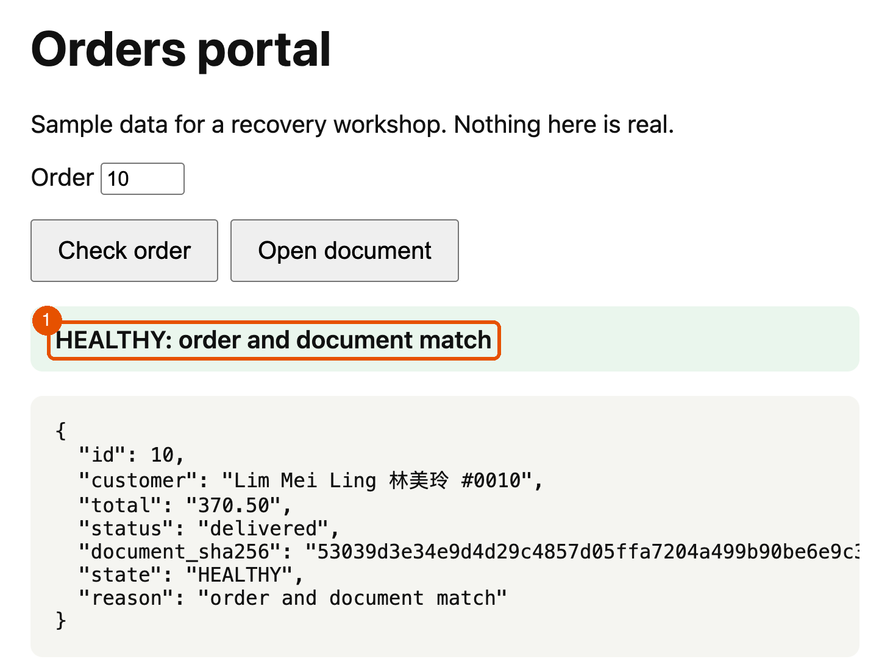

# 5. Survive

**Requires:** [4. Recover the orders](4-orders.md). In a new terminal, first [start a session](0-setup.md#start-a-session).

Next, the worst case. Anything with enough access to the account can delete the database and the bucket, and with them the copies kept in the account: the automated backups and every object version. In this module, you delete all of it, then recover from Clumio's air-gapped recovery points, kept outside your organization's security domain.

**With only the copies in this account:** a database deleted with its automated backups leaves no backup behind, and a deleted bucket takes its versions with it. Nothing is left in the account to restore from.

## Delete everything

> [!IMPORTANT]
> You can't undo this. Check that `terraform.tfvars` names your test account.

1. Delete the database with its automated backups, and the bucket with every version. The command lists what it will delete. Enter the account ID to continue.

   ```bash
   ./lab break everything
   ```

   **You should see:**

   ```text
   Everything is gone from the account. Next: ./lab check, then recover with Clumio (docs/5-survive.md)
   ```

2. Check the application.

   ```bash
   ./lab check
   ```

   **You should see:**

   ```text
     database             missing
     documents bucket     missing
     control order 1      BROKEN
   BROKEN
   ```

3. In the portal, check order `10`: `database unavailable`. In the Amazon RDS console, choose **Automated backups**: nothing is listed for `orders-db`.

   

4. See what protects Clumio's copies. In the Clumio console, choose **Administration**, **Backup deletion**. Look only, and don't submit anything. Deleting a recovery point before its retention ends takes a request from a Super Admin, approved by a second person in your organization, which Clumio then reviews. Even someone with full access to the account, or to Clumio, can't quietly delete your way back.

   

## Restore the database

To bring the application back unchanged, restore the database under its original name, `orders-db`. The application and `./lab` find the database by name, so nothing else needs to change.

5. In the Clumio console, choose **AWS**, **Inventory**, **RDS resources**. Filter **Status in AWS** to **Deleted resources**. Choose `orders-db`. If it isn't listed, clear the filter, and look for `orders-db` marked as deleted. If more than one is listed, first, at the top of **Inventory**, choose your account in **All accounts** and your Region in **All regions**: other learners on the same Clumio tenant can have one too. If you restore a copy from another deployment in your account, `./lab check` says so.

   

6. Choose the last SecureVault Standard recovery point before the change time. Then choose **Restore**. Choose **Default** first, then enter `orders-db` for **Aurora cluster name**. Switching between **Default** and **Custom** clears the name, so check it before you choose **Restore**. In the test run, the restore took 20 minutes.

> [!NOTE]
> **While you wait:** the source database no longer exists in AWS, but its recovery points do, in Clumio's vault. Clumio copies one into your account as a snapshot, builds `orders-db` from it, then deletes the snapshot.

7. When the task completes, make the cluster ready for SQL.

   ```bash
   ./lab prepare orders-db
   ```

   **You should see:**

   ```text
   orders-db answers SQL
   ```

## Restore the documents

A SecureVault restore for S3 writes into a bucket that exists, and that Clumio already knows. You recreate the empty bucket first.

8. Recreate the documents bucket, empty, with the same name, settings, and tag.

   ```bash
   ./lab rebuild
   ```

   **You should see:**

   ```text
   orders-documents-<account ID>-<region> recreated, empty and tagged for Clumio. Next: wait until Clumio lists it, then restore into it
   ```

9. In the Clumio console, choose **AWS**, **Inventory**, **S3 buckets**. Wait until `orders-documents-<account ID>-<region>` is listed again. This can take up to an hour. In the test run, it took 5 minutes. The deleted bucket stays listed too, with its **Restore** greyed out: its recovery points are on the protection group, the next step.

10. Choose **AWS**, **Protect**, **S3**, **Protection Groups**, then `orders-s3-<account ID>-<region>`. In the calendar, find the latest backup from before the change time. It may be on an earlier date, since the backup runs once a day. A newer backup can be listed too: it's of the empty rebuilt bucket, which the workshop's policy protected at once, because it has the tag. Choose the one from before the change time, then its **Restore** menu, then **Restore prefix/buckets**.

    

11. Select the bucket `orders-documents-<account ID>-<region>` from the backup. It shows 1,000 objects. Skip the object preview, so every object is restored. Under **Restore to**, choose **Custom**, not **Source**. **Source** means the bucket that was deleted, and Clumio refuses it with Error 111. Keep the account and Region from the source. For **Bucket name**, choose `orders-documents-<account ID>-<region>`, the bucket you rebuilt. Leave **Prefix to restore data at** empty. Choose **Restore**. In the test run, the restore took 4 minutes.

    

12. When the task completes, check the application.

    ```bash
    ./lab check
    ```

    **You should see:**

    ```text
      schema               matches
      totals               1000 orders, 2419000.00 in total, 142 notes NULL
      orders missing       0
      orders changed       0
      documents missing    0
      documents changed    0
      control order 1      intact
    HEALTHY
    ```

    The restored database passed both checks: every order and document, and `schema  matches`, the same columns, types and indexes as before the deletion.

13. In the portal, check order `10`: HEALTHY. The same page works, because the restored database and bucket have their original names.

    

> [!NOTE]
> In this workshop, use recovery points from before the change time in Module 2. A later one could have been taken between the bad deployment and your repairs, and would hold the bad deployment's damage. In production, choose the latest point taken while the data was healthy.

**Key takeaway:** Every copy in the account was gone, and the application came back from Clumio's air-gapped recovery points. Isolation keeps a way back when the blast radius covers the whole account.

**Next:** [6. Prove](6-prove.md)
