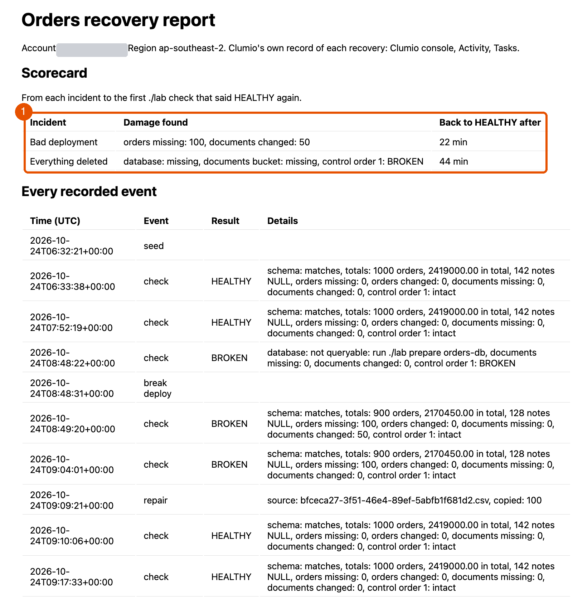
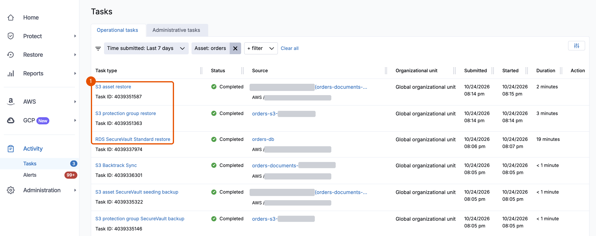

# 6. Prove

**Requires:** [5. Survive](5-survive.md). In a new terminal, first [start a session](0-setup.md#start-a-session).

A completed restore isn't the same as a recovered application. The data must be right, and you must be able to show it, with numbers. In this module, you read your scorecard, then match it with Clumio's own record of each restore.

1. Show the scorecard. For each incident, it lists the damage the first BROKEN check found, and the time from the incident to the first check that said HEALTHY again.

   ```bash
   ./lab report
   ```

   **You should see** your own times:

   ```text
     incident             back to HEALTHY after   damage found
     Bad deployment       <your time>             orders missing: 100, documents changed: 50
     Everything deleted   <your time>             database: missing, documents bucket: missing, control order 1: BROKEN
   ```

   A row without a time says how that incident ended instead: `not HEALTHY yet`, `not recovered (./lab down)`, `not recovered before the next incident`, or `no damage found` with `not applicable`, when a break stopped before it did any damage.

2. Open the report it wrote, `.lab/report.html`, in a browser. On macOS, run `open .lab/report.html`. Below the scorecard, it lists every recorded event with its time in UTC: each check, each incident, the repair, and the bucket rebuild.

   

3. In the Clumio console, choose **Activity**, **Tasks**. Find each restore you ran: the Backtrack in Module 3, the record restore and the database restore in Module 4, and the database and document restores in Module 5. Each task shows when it started, when it ended, and its status.

   

4. Compare the two. Clumio's task times show how long each restore took. Your scorecard shows how long the application took to work again, including finding the damage, choosing the way back, and checking the result. That second number is the one your team and your customers feel.

5. Hold the scorecard against AnyCompany's impact tolerance, from the [README](../README.md#key-concepts): no order lost, and every order back within one hour. `HEALTHY` proves the first part. The scorecard's times prove the second. In the test run, both incidents met it, at 22 and 44 minutes. If one of yours missed it, the report's list of events shows which step took the time.

**Key takeaway:** Clumio's task records show what was restored and when. Your check shows the application works again. Together, they're evidence you can show, and a time you can measure again after every restore test.

**Next:** [7. Clean up](7-clean-up.md)
